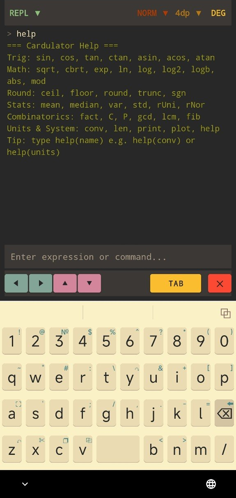
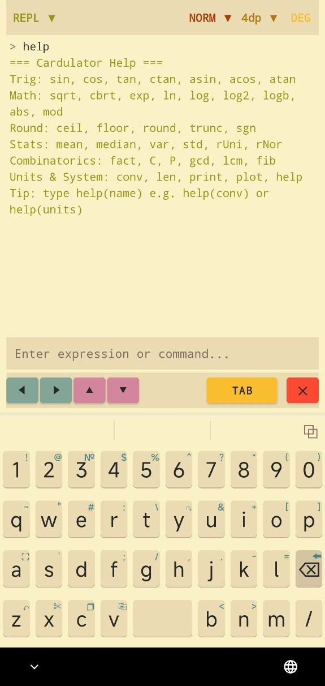
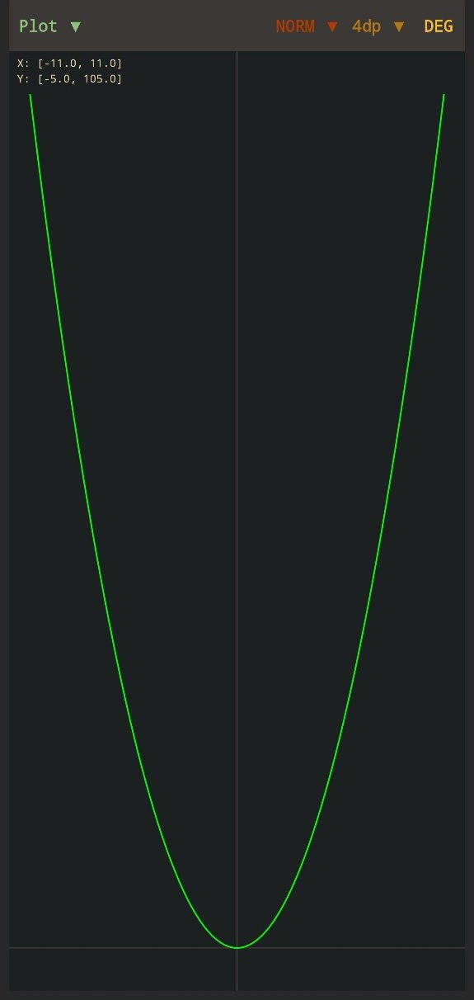
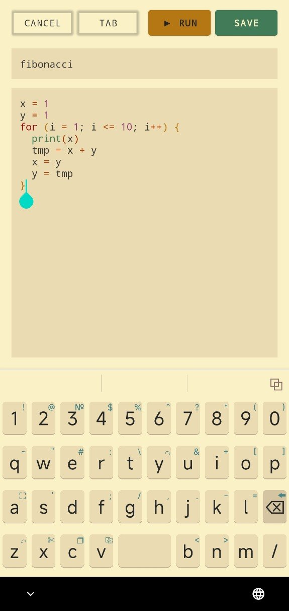
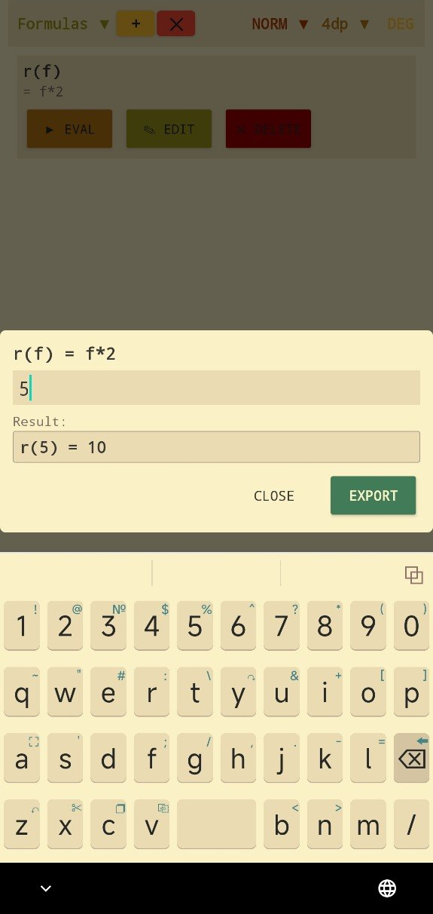
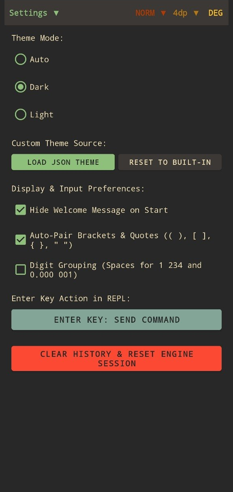

# Droidulator — Scientific REPL Calculator & Scripting Engine for Android


**Droidulator** is a powerful, feature-rich scientific mathematical calculator and REPL scripting environment for Android devices, ported from the original [Cardulator](https://github.com/aroum/cardulator) C++ engine.

Built with Kotlin for the Android UI and a high-performance C++ NDK core (`TinyExpr-PlusPlus` + `GNU Units`), Droidulator provides real-time Gruvbox-themed syntax highlighting, 7-stage rainbow bracket matching, SI prefix parsing, scientific notation, user variables and functions, interactive multi-argument formula wizards, a C-style scripting engine with 1D array support, REPL script runner `run("script_name")`, interactive 2D function plotting, and persistent JSON storage.

<p align="center">
  
  
  
</p>
<p align="center">
  
  
  
</p>

---

## Key Features

- **High-Performance REPL**: Interactive evaluation loop with `Tab` autocompletion, 1-based answer history (`e1`, `e2`...), SI prefix parsing (`1k` = `1000`, `2M2` = `2,200,000`), scientific notation (`5e10`), and multi-statement execution using `;`.
- **Gruvbox Design & Theme Engine**: Sleek dark and light mode UI powered by a centralized `ThemePalette` design system matching the iconic Gruvbox retro aesthetic.
- **Dynamic Syntax Highlighting & Rainbow Brackets**: Real-time syntax coloring (purple numbers, aqua functions, yellow constants, red keywords/errors, orange operators) with 7-level depth rainbow bracket matching (`( )`, `[ ]`, `{ }`).
- **Interactive Script Editor & Runner (`run("script_name")`)**:
  - Full-screen script editor with `Cancel`, `TAB`, `RUN`, and `SAVE` controls.
  - In-editor `TAB` button for local variable & global symbol autocompletion.
  - Dedicated REPL command `run("script_name")` with `Tab` autocompletion to execute saved scripts directly from the calculation prompt and inspect output.
- **Formula Library & Parameter Wizard**: Multi-argument formula manager using standard `f(x, y) = expression` syntax. Interactive parameter dialog calculates live preview without side effects and exports results directly into REPL history with sequential `e#` variables.
- **2D Function Plotting Engine**: Interactive Matplotlib-style function and vector plotter (`plot(y)`, `plot(x, y, color, linestyle)`) with hold overlays (`plot.hold(1)`), custom axis bounds (`plot.xlim`, `plot.ylim`), panning, and zooming.
- **GNU Units Integration**: Built-in physical unit conversion and evaluation engine powered by C++ GNU Units library.
- **Persistent Storage**: Automatic JSON-based storage (`user_data.json`) preserving user variables, formulas, constants, and scripts across app restarts.

---

## User Interface & Navigation

Droidulator features a mode selection dropdown at the top navigation header bar to switch between views:

| Mode | Functionality |
| :--- | :--- |
| **Calculator (REPL)** | Primary REPL terminal for live calculation, history review, script running `run()`, and navigation toolbar. |
| **Scripts** | Manage saved user scripts. Create new scripts, edit existing ones, run scripts with popup output logs, or delete scripts. |
| **Variables** | Unified variable manager (`x = 42`, `e#` history variables). Single-field definition editor for inline modification and removal. |
| **Formulas** | Interactive formula library (`f(x) = x^2 + 2*x`). Tap a formula to open the live parameter preview wizard and export results to REPL. |
| **Constants** | Custom & built-in constant definitions (`const MY_PI = 3.14159`). |
| **Plot** | 2D graph viewer for interactive function visualization and plotting. |
| **Settings** | Configure number formatting modes, decimal precision (DP), digit grouping, `e#` history variable visibility, and light/dark theme modes. |
| **Help** | Contextual help reference for available functions, operators, and syntax. |

---

## Display Formatting & Precision Modes (DP & Settings)

Droidulator provides fine-grained control over numerical result representation via the top header bar spinners or the **Settings** menu:

### 1. Display Formatting Modes (FMT)

- **`NORM` (Normal)**: Default floating-point representation. Drops unnecessary trailing zeros.
- **`FLT` (Float)**: Standard floating-point output with default precision.
- **`FIX` (Fixed Point)**: Rounds results to a fixed number of decimal places defined by **DP**. (e.g., `3.14159265` $\rightarrow$ `3.141593` at 6 DP).
- **`SCI` (Scientific Notation)**: Displays numbers in exponential $m \times 10^n$ format (e.g., `1.234567e+06`).
- **`ENG` (Engineering Notation)**: Displays numbers in scientific notation where the exponent is restricted to multiples of 3 (e.g., $10^3, 10^6, 10^{-3}$), matching standard SI engineering units.

### 2. Decimal Precision (DP / `fmt_prec`)

- Configurable decimal precision level ranging from **0 to 12 decimal places** (default: **6 DP**).
- Directly controls fractional digit rounding across `FIX`, `SCI`, and `ENG` modes.

### 3. Additional Formatting Preferences

- **Digit Grouping (Thousands Separator)**: Toggles space separators for large numbers (e.g., `1 000 000.00` vs `1000000.00`).
- **History Variable Visibility (`#` / `e#`)**: Toggle (`ON`/`OFF`) displaying sequential history evaluation results (`e1 = ...`, `e2 = ...`) in the **Variables** manager tab.
- **Hide Welcome Message on Start**: Toggle (`ON`/`OFF`) hiding the initial welcome banner in the REPL terminal.
- **Auto-Pair Brackets & Quotes**: Toggle (`ON`/`OFF`) automatic insertion of closing pairs for `( )`, `[ ]`, `{ }`, `" "`, `' '`.

---

## Theme Management & Custom JSON Themes

Droidulator supports dynamic theme switching via **Settings**:
- **Auto**: Automatically matches Android system Day/Night mode.
- **Dark**: Dark palette mode.
- **Light**: Light palette mode.
- **Custom Theme Source**: Load custom JSON theme files directly from device storage or reset to built-in defaults.

### Custom JSON Theme Specification

A custom theme file contains a JSON object with optional `"dark"` and `"light"` sections. Every color is defined as a hexadecimal RGB/RGBA string (e.g., `"#282828"`).

#### Theme JSON Schema

```json
{
  "dark": {
    "bg": "#282828",
    "bg_soft": "#3C3836",
    "bg_card": "#3C3836",
    "bg_dark_text": "#282828",
    "fg_text": "#EBDBB2",
    "fg_dim": "#A89984",
    "fg_inverted": "#282828",
    "border_color": "#504945",
    "aqua": "#689D6A",
    "green": "#8EC07C",
    "yellow": "#FABD2F",
    "yellow_dark": "#D79921",
    "orange": "#FE8019",
    "orange_dark": "#D65D0E",
    "red": "#FB4934",
    "purple": "#D3869B",
    "blue": "#83A598",
    "rainbow_0": "#FABD2F",
    "rainbow_1": "#FE8019",
    "rainbow_2": "#FB4934",
    "rainbow_3": "#D3869B",
    "rainbow_4": "#83A598",
    "rainbow_5": "#8EC07C",
    "rainbow_6": "#B8BB26"
  },
  "light": {
    "bg": "#FBF1C7",
    "bg_soft": "#EBDBB2",
    "bg_card": "#EBDBB2",
    "bg_dark_text": "#282828",
    "fg_text": "#3C3836",
    "fg_dim": "#7C6F64",
    "fg_inverted": "#FBF1C7",
    "border_color": "#A89984",
    "aqua": "#427B58",
    "green": "#98971A",
    "yellow": "#B57614",
    "yellow_dark": "#B57614",
    "orange": "#AF3A03",
    "orange_dark": "#AF3A03",
    "red": "#9D0006",
    "purple": "#8F3F71",
    "blue": "#076678",
    "rainbow_0": "#B57614",
    "rainbow_1": "#AF3A03",
    "rainbow_2": "#9D0006",
    "rainbow_3": "#8F3F71",
    "rainbow_4": "#076678",
    "rainbow_5": "#427B58",
    "rainbow_6": "#79740E"
  }
}
```

### Example Custom Theme (Tokyo Night Style)

Save the snippet below as `tokyo_night.json` and load it via **Settings $\rightarrow$ Load JSON Theme**:

```json
{
  "dark": {
    "bg": "#1a1b26",
    "bg_soft": "#24283b",
    "bg_card": "#24283b",
    "bg_dark_text": "#1a1b26",
    "fg_text": "#c0caf5",
    "fg_dim": "#565f89",
    "fg_inverted": "#1a1b26",
    "border_color": "#414868",
    "aqua": "#7dcfff",
    "green": "#9ece6a",
    "yellow": "#e0af68",
    "yellow_dark": "#e0af68",
    "orange": "#ff9e64",
    "orange_dark": "#ff9e64",
    "red": "#f7768e",
    "purple": "#bb9af7",
    "blue": "#7aa2f7",
    "rainbow_0": "#e0af68",
    "rainbow_1": "#ff9e64",
    "rainbow_2": "#f7768e",
    "rainbow_3": "#bb9af7",
    "rainbow_4": "#7aa2f7",
    "rainbow_5": "#7dcfff",
    "rainbow_6": "#9ece6a"
  }
}
```

---

## Mathematical Engine & Syntax

### 1. Arithmetic & Power Operators

- Addition `+`, Subtraction `-`, Multiplication `*`, Division `/`, Modulo `%` (or `mod(a, b)`).
- Exponentiation `^` (e.g., `2^10` $\rightarrow$ `1024`). Supports fractional exponents (`8^(1/3)` $\rightarrow$ `2`).
- Negation `-x` and unary plus `+x`.

### 2. Trigonometry (Degree & Radian Mode)

Default angular unit is **Degrees**.

- `sin(x)`, `cos(x)`, `tan(x)`, `ctan(x)` — Standard trigonometric functions (takes degrees).
- `asin(x)`, `acos(x)`, `atan(x)` — Inverse trigonometric functions (returns degrees).
- Radians conversions: `deg2rad(x)` (or `d2r(x)`), `rad2deg(x)` (or `r2d(x)`).

### 3. Logarithms & Exponential Functions

- `ln(x)` — Natural logarithm (base $e$).
- `log(x)` (or `log10(x)`) — Common logarithm (base 10).
- `log2(x)` — Binary logarithm (base 2).
- `logb(x, base)` — Logarithm with arbitrary base.
- `exp(x)` — Exponential function $e^x$.

### 4. Rounding & Absolute Value

- `abs(x)` — Absolute value / magnitude.
- `sqrt(x)` / `cbrt(x)` — Square root / Cube root.
- `floor(x)`, `ceil(x)`, `round(x)`, `trunc(x)`.
- `sgn(x)` — Signum function (-1 for $x < 0$, 0 for $x = 0$, 1 for $x > 0$).

### 5. Statistics & Vector Operations

- `mean(a1, a2, ...)` — Arithmetic mean of sample.
- `median(a1, a2, ...)` — Median of sample.
- `std(a1, a2, ...)` — Standard deviation.
- `var(a1, a2, ...)` — Sample variance.
- `min(a1, a2, ...)` / `max(a1, a2, ...)` — Minimum / maximum value.

### 6. Combinatorics & Special Functions

- `C(n, k)` (or `Cnk(n, k)`) — Binomial coefficient (combinations $n$ choose $k$).
- `P(n, k)` — Permutations $n$ P $k$.
- `fact(n)` (or `n!`) — Factorial.
- `gcd(a, b, ...)` — Greatest common divisor.
- `lcm(a, b, ...)` — Least common multiple.
- `fib(n)` — $n$-th Fibonacci number.

### 7. Built-in Constants

- `pi` — Mathematical constant $\pi \approx 3.141592653589793$
- `e` — Euler's number $e \approx 2.718281828459045$

#### Disambiguation of `e` Contexts

1. **Constant `e`**: Standalone lowercase token (e.g., `e`, `e^2`, `2*e`).
2. **Scientific Notation**: Numerical suffix exponent (e.g., `5e10` $= 5 \times 10^{10}$, `1e-5` $= 10^{-5}$).
3. **REPL History Variables**: Sequential history reference (e.g., `e1`, `e2`, `e3`).

---

## Numerical Precision & Limitations

Droidulator performs all mathematical evaluations using **64-bit IEEE 754 Double-Precision Floating-Point** arithmetic (`double`):

- **Significant Precision**: 53-bit significand (~15–17 decimal digits of precision).
- **Exact Integers**: Exact integer representation up to $\pm 2^{53}$ ($\pm 9,007,199,254,740,992$).
- **Dynamic Range**: Numbers from $\approx \pm 2.225 \times 10^{-308}$ to $\approx \pm 1.797 \times 10^{308}$.
- **Special Values**: Full IEEE 754 support for `+inf` / `-inf` (overflow / division by zero) and `NaN` (undefined indeterminate forms).

---

## SI Prefixes

Droidulator supports standard SI prefixes directly within expressions (e.g., `1.5k + 200` $\rightarrow$ `1700`). SI prefixes can also replace the decimal separator in R-notation (e.g., `1k7` $\rightarrow$ `1700`).

### Multipliers ($\ge 1$)

| Power     | Prefix | Symbol | Example                |
| :-------- | :----- | :----- | :--------------------- |
| $10^1$    | deca   | `da`   | `1da` = `10`           |
| $10^2$    | hecto  | `h`    | `1h` = `100`           |
| $10^3$    | kilo   | `k`    | `1.5k` = `1500`        |
| $10^6$    | mega   | `M`    | `2M2` = `2,200,000`    |
| $10^9$    | giga   | `G`    | `1G` = `1,000,000,000` |
| $10^{12}$ | tera   | `T`    | `1T` = `10^{12}`       |
| $10^{15}$ | peta   | `P`    | `1P` = `10^{15}`       |
| $10^{18}$ | exa    | `E`    | `1E` = `10^{18}`       |
| $10^{21}$ | zetta  | `Z`    | `1Z` = `10^{21}`       |
| $10^{24}$ | yotta  | `Y`    | `1Y` = `10^{24}`       |

### Submultipliers ($< 1$)

| Power      | Prefix | Symbol | Example                |
| :--------- | :----- | :----- | :--------------------- |
| $10^{-1}$  | deci   | `d`    | `1d` = `0.1`           |
| $10^{-2}$  | centi  | `c`    | `1c` = `0.01`          |
| $10^{-3}$  | milli  | `m`    | `100m` = `0.1`         |
| $10^{-6}$  | micro  | `u`    | `10u` = `0.00001`      |
| $10^{-9}$  | nano   | `n`    | `1n5` = `0.0000000015` |
| $10^{-12}$ | pico   | `p`    | `1p` = `10^{-12}`      |
| $10^{-15}$ | femto  | `f`    | `1f` = `10^{-15}`      |
| $10^{-18}$ | atto   | `a`    | `1a` = `10^{-18}`      |
| $10^{-21}$ | zepto  | `z`    | `1z` = `10^{-21}`      |
| $10^{-24}$ | yocto  | `y`    | `1y` = `10^{-24}`      |

---

## Unit Conversions & Component Marking (`conv`)

Droidulator provides native support for physical unit conversions, logarithmic ratio calculations, and electronic component marking code conversions (SMD 3-digit, SMD 4-digit, EIA-96, and RKM notation).

### 1. Physical Units & Logarithmic Ratios

- **Physical & Engineering Units**: `conv(5, "mile", "km")`, `conv(100, "km/hr")`, `conv(24, "AWG", "mm^2")`.
- **dB & Power/Voltage Ratios**: `conv(30, "dBm", "mW")`, `conv(20, "dB", "times")` *(Power 100x)*, `conv(20, "dB_v", "times")` *(Voltage 10x)*.

### 2. Component Code & RKM Marking Conversions

The `conv()` function handles conversion between numeric values (in base SI units like $\Omega$, $\text{F}$, $\text{H}$) and component marking codes.

#### Passing Arguments & Syntax
- **Marking Code String to Value**: Strings with marking codes **must be enclosed in quotes**:
  - `conv("01C", "ohm")` $\rightarrow$ `10000 ohm` *(10 kΩ)*
  - `conv("104", "uf")` $\rightarrow$ `0.1 uF` *(100 nF)*
  - `conv("4R7", "uh")` $\rightarrow$ `4.7 uH`
- **Numeric Value to Code**: Numbers are passed directly without quotes:
  - `conv(10000, "eia96")` $\rightarrow$ `"01C"`
  - `conv(4700, "smd3")` $\rightarrow$ `"472"`
  - `conv(4700, "smd4")` $\rightarrow$ `"4701"`
  - `conv(220, "smd3")` or `conv(220, "ohm", "smd3")` $\rightarrow$ `"221"`
- **Code to Code Conversion**: `conv("472", "smd4")` $\rightarrow$ `"4701"`.

#### Resistor Code Formats (Standard E-Series Values)

- **SMD 3-Digit (`smd3`)**: 2-digit mantissa + 1-digit exponent ($M \times 10^E \;\Omega$).
  - `conv("100", "ohm")` $\rightarrow$ `10 ohm` *(E24)*
  - `conv("472", "ohm")` $\rightarrow$ `4700 ohm` *(4.7 kΩ, E24)*
  - `conv("104", "ohm")` $\rightarrow$ `100000 ohm` *(100 kΩ, E24)*
- **SMD 4-Digit (`smd4`)**: 3-digit mantissa + 1-digit exponent ($M \times 10^E \;\Omega$).
  - `conv("1000", "ohm")` $\rightarrow$ `100 ohm` *(E96)*
  - `conv("4701", "ohm")` $\rightarrow$ `4700 ohm` *(4.7 kΩ, E96)*
  - `conv("1002", "ohm")` $\rightarrow$ `10000 ohm` *(10 kΩ, E96)*
- **RKM Decimal Notation (`2R2`, `R2`, `4R7`)**: Uses letters `R` / `K` / `M` / `P` / `N` / `U` as decimal points without interfering with user variables:
  - `conv("R22", "ohm")` $\rightarrow$ `0.22 ohm` *(E24)*
  - `conv("2R2", "ohm")` $\rightarrow$ `2.2 ohm` *(E24)*
  - `conv("4R7", "ohm")` $\rightarrow$ `4.7 ohm` *(E24)*
- **EIA-96 1% Precision Code (`eia96`)**: 2-digit value lookup index (01–96) + 1-character multiplier letter.

#### EIA-96 Multiplier Letter Specification

All standard and alternative EIA-96 multiplier letters are supported on input:

| Multiplier Letter | Multiplier Factor | Example Code | Equivalent Resistance |
| :---------------- | :---------------- | :----------- | :-------------------- |
| **`Z`**           | $0.001$           | `"01Z"`      | `0.1 ohm`             |
| **`Y`** or **`R`**| $0.01$            | `"01Y"`, `"01R"` | `1 ohm`           |
| **`X`** or **`S`**| $0.1$             | `"01X"`, `"01S"` | `10 ohm`          |
| **`A`**           | $1$               | `"01A"`      | `100 ohm` *(E96 index 01 = 100)* |
| **`B`** or **`H`**| $10$              | `"01B"`, `"01H"` | `1000 ohm` *(1 kΩ)*   |
| **`C`**           | $100$             | `"01C"`      | `10000 ohm` *(10 kΩ)* |
| **`D`**           | $1000$            | `"01D"`      | `100000 ohm` *(100 kΩ)* |
| **`E`**           | $10000$           | `"01E"`      | `1000000 ohm` *(1 MΩ)*|
| **`F`**           | $100000$          | `"01F"`      | `10000000 ohm` *(10 MΩ)*|

#### Capacitance & Inductance Codes

- **Capacitance Marking Codes**: 3-digit pF base codes and RKM pF/nF/uF markings:
  - `conv("104", "uf")` $\rightarrow$ `0.1 uF` *(100 nF)*
  - `conv("473", "nf")` $\rightarrow$ `47 nF`
  - `conv("4p7", "pf")` $\rightarrow$ `4.7 pF`
- **Inductance Marking Codes**: 3-digit uH base codes and RKM uH/nH markings:
  - `conv("4R7", "uh")` $\rightarrow$ `4.7 uH`
  - `conv("101", "uh")` $\rightarrow$ `100 uH`
  - `conv("10n", "nh")` $\rightarrow$ `10 nH`

---

## Arrays, Ranges & Inline Conditions/Loops

### 1. Arrays & Ranges

- **Simple Range (step = 1)**: `start:end` (e.g., `1:10` $\rightarrow$ `[1, 2, 3, 4, 5, 6, 7, 8, 9, 10]`)
- **Range with Step**: `start:step:end` (e.g., `1:2:10` $\rightarrow$ `[1, 3, 5, 7, 9]`, `10:-1:1` $\rightarrow$ `[10, 9, ..., 1]`)
- **Indexing (1-based)**: `(1:2:10)[1]` $\rightarrow$ `1`

### 2. Inline Conditionals (If / Else)

- `if(condition, expr_true, expr_false)` (e.g., `if(5 > 3, 10, 20)` $\rightarrow$ `10`)
- Multi-branch condition: `iff(cond1, val1, cond2, val2, ..., default)` (e.g., `iff(x > 0, 1, x < 0, -1, 0)`)

### 3. Inline Mathematical Loops

- **Summation**: `sum(index, start, end, expr)` (e.g., `sum(i, 1, 10, i^2)` $\rightarrow$ $\sum_{i=1}^{10} i^2 = 385$)
- **Product**: `prod(index, start, end, expr)` (e.g., `prod(i, 1, 5, i)` $\rightarrow$ $5! = 120$)
- **Range Min/Max**: `min(index, start, end, expr)` / `max(index, start, end, expr)`

---

## Custom Variables & Functions

### 1. User Variables & Constants

- Variables: `temp = 25`, then `temp * 2` $\rightarrow$ `50`.
- Constants: `const a = 3`. Constants can be updated with explicit `const` (`const a = 2`), but assigning `a = 10` raises a `Const Error`.

### 2. User Functions & Formulas

- **Single-line functions**: `f(x) = x^2` or `f(x, y) = 2*x + y`
- **Multi-line / Block functions (`fn` / `def` / `function`)**:

  ```c
  fn calculate(a, b) {
      c = a * 2;
      return c + b
  }
  ```

- **Multiple statements on one line**: Separate instructions with `;` (e.g., `x = 5; y = 10; x + y` $\rightarrow$ `15`).

---

## Scripting Engine & REPL `run()` Command

The script manager allows creating, editing, and executing multi-line C-style programs with structural logic.

### 1. Syntax & Features

- **Conditionals**:

  ```c
  if (x > 10) {
      print("x is large")
  } else if (x > 5) {
      print("x is medium")
  } else {
      print("x is small")
  }
  ```

- **Loops**:
  - `while (cond) { ... }`
  - `for (i = 1; i <= 10; i++) { ... }`
- **Assignments & Shorthands**: `i++`, `i--`, `a += b`, `a -= b`.
- **Execution Control & Output**:
  - `sleep(ms)` — Pause execution for specified milliseconds.
  - `print("Text {expr}")` — Formatted printing with interpolated expressions inside curly braces.
- **1D Arrays in Scripts**:
  - Creation: `A = [1, 2, 3]` or `A = 1:10`.
  - 1-based Indexing: `A[1] = 99`.
  - Element-wise Math: `C = A .* B`, `C = A ./ B`, `C = A + B`, `C = A * 5`.
  - Dot Product: `dot_val = A * B`.
  - Length: `len(A)`.

### 2. Running Scripts from REPL

Execute any saved script directly from the REPL input prompt:

```text
> run("my_script")
```

- Typing `run(` in REPL and pressing **`Tab`** automatically suggests registered user script names.

---

## 2D Plotting Engine

Visualize functions or datasets directly on screen.

### Commands & Controls

- `plot(x, y)` / `plot(y)` — Plot array/vector data.
- `plot(x, y, color, linestyle)` — Plot with custom color (`"r"`, `"g"`, `"b"`, `"c"`, `"m"`, `"y"`, `"k"`, `"w"`) and line style (`"-"`, `"--"`, `"-."`, `":"`, `""`).
- `plot.show()` / `plot.close()` — Open / close plot display.
- `plot.hold(1)` / `plot.hold(0)` — Retain overlay of multiple plots.
- `plot.xlim([min, max])` / `plot.ylim([min, max])` — Manual axis limit boundaries.

---

## Building & Installation

### Prerequisites

- Android Studio (Ladybug or newer recommended) or Android SDK + NDK.
- Java JDK 17 / 21.
- CMake 3.22+.

### Clone Repository

```bash
git clone --recursive https://github.com/aroum/droidulator.git
cd droidulator
```

### Build APK

```bash
./gradlew assembleDebug
```

---

## License
 
This project is licensed under the [GNU General Public License v3.0 (GPLv3)](LICENSE).
 
- **GNU Units**: Licensed under the GNU General Public License v3.0 (GPLv3).
- **TinyExpr++**: Licensed under the zlib License.
